# Module dependency map

This map separates three kinds of relationship. Only the third would count as an implementation dependency.

| Layer | Meaning | Status |
|---|---|---|
| A. Conceptual flow | Recovered conceptual ordering ("feeds into") | Recovered conceptual model. PROPOSED initial flow. |
| B. Associations | Module groups linked to the flow without specified attachment points | Grouping recovered; attachment points UNRESOLVED |
| C. Implementation dependencies | Actual `using`/`import`/call edges in `src/` | **None exist.** No module is implemented. |

## A. Conceptual flow (not import edges)

```mermaid
flowchart LR
  CE[CyclotomicEmbedding] -.-> FGL[FractalGradientLayer]
  FGL -.-> PCM[PolyhedralCoordinateMapper]
  PCM -.-> BCR[BlockChamberRouter]
  BCR -.-> CSA[CarrySkipAdder]
  CSA -.-> AA[ActivationAggregator]
  AA -.-> ECD[EulerClassDecoder]
  ECD -.-> SPC[SymbolicPolicyComposer]
  SPC -.-> FAL[FeedbackAwareLoop]
```

Dotted arrows mean "conceptually precedes". They do not imply direction of code dependency,
synchronous execution or mandatory sequencing (`execution_lifecycle.md`).

| From | To | Layer | Status |
|---|---|---|---|
| CyclotomicEmbedding | FractalGradientLayer | A | Conceptual; contract UNRESOLVED |
| FractalGradientLayer | PolyhedralCoordinateMapper | A | Conceptual; contract UNRESOLVED |
| PolyhedralCoordinateMapper | BlockChamberRouter | A | Conceptual; contract UNRESOLVED |
| BlockChamberRouter | CarrySkipAdder | A | Conceptual; contract UNRESOLVED |
| CarrySkipAdder | ActivationAggregator | A | Conceptual; contract UNRESOLVED |
| ActivationAggregator | EulerClassDecoder | A | Conceptual; contract UNRESOLVED |
| EulerClassDecoder | SymbolicPolicyComposer | A | Conceptual; contract UNRESOLVED |
| SymbolicPolicyComposer | FeedbackAwareLoop | A | Conceptual; contract UNRESOLVED |

## B. Associated groups (no edges recorded)

| Group | Modules | Attachment to flow |
|---|---|---|
| Reward and rule learning | RewardAutomaton, RuleMiner | UNRESOLVED. FeedbackAwareLoop's responsibility mentions "downstream reward or policy behavior", but no edge is specified. |
| Rule evaluation | ConfidencePruner | UNRESOLVED |
| Rule governance and organization (membership PROPOSED) | RuleLifecycleManager, RuleCareerManager, RuleMigrationAudit, RuleLineageGraph, RuleClusterSwarm | UNRESOLVED |
| Planning and coordination | SymbolicPlannerAgents, MetaAgentDelegator | UNRESOLVED |

## C. Implementation dependencies

| From | To | Kind | Source |
|---|---|---|---|
| — | — | — | None. No module source exists. |

## Constraints

- No circular code dependencies between modules (rule in `CLAUDE.md`).
- How the runtime feedback cycle implied by FeedbackAwareLoop relates to that rule is UNRESOLVED (Q-ARCH-6).

## Dependency readiness

The first dependency-ready module is UNRESOLVED. CyclotomicEmbedding has no conceptual upstream module,
which makes it a natural *candidate* (PROPOSED). Its contract (Q-MATH-1, Q-PROF-*) is still unresolved,
so it is not ready.
